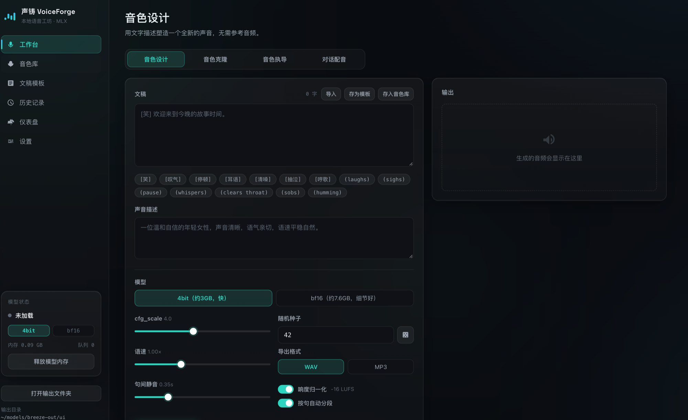

# 声铸 VoiceForge · 本地语音工坊

基于 MLX 的 Apple Silicon 本地语音控制台：音色设计 / 克隆 / 执导 / 多角色对话配音，
带音色库、文稿模板、加工流水线仪表盘与模型管理中心。



## 结构

```
├── app.py                 # 入口：创建应用并启动 uvicorn（薄）
├── server/                # FastAPI 后端（分层）
│   ├── config.py          # 配置层：路径/设置/模型清单/常量/工具
│   ├── engine.py          # 引擎层：MLX 加载、分段、合成、音频后处理（不感知 HTTP）
│   ├── jobs.py            # 任务系统：队列 + 工作线程 + 四类任务执行
│   ├── app.py             # 应用工厂：组装路由、异常处理、前端托管
│   └── routers/           # HTTP 层
│       ├── system.py      # 状态/设置/模型配置与下载/统计/系统操作
│       ├── synthesis.py   # 合成、对话配音、任务查询/取消/再生成
│       ├── library.py     # 音色库、文稿模板
│       └── history.py     # 历史记录与音频文件服务
├── frontend/              # React 前端（Vite 构建）
│   └── src/
│       ├── store.jsx      # 全局状态：任务轮询/队列、模型切换、数据加载
│       ├── App.jsx        # 侧边栏 + 视图路由
│       └── views/         # 工作台/音色库/模板/历史/仪表盘/设置
└── frontend/dist/         # 构建产物（后端直接托管）
```

分层约定：`routers` 只做参数校验与组装，不碰 MLX；`engine` 只做推理与音频处理，
不感知 HTTP；`jobs` 串联两者并管理生命周期；`config` 被所有层运行时访问
（输出目录支持热更新，因此禁止 from-import 绑定）。

数据（音色库、模板、设置、模型配置）存放在 `~/models/breeze-out/ui/`，不随仓库管理。

## 使用

```bash
~/breeze-env/bin/python ~/voiceforge/app.py    # 打开 http://127.0.0.1:7860
```

停止：`pkill -f "voiceforge/app.py"`（会同时释放模型占用的内存）。

## 前端开发

```bash
cd frontend
npm install
npm run dev      # http://127.0.0.1:5173（/api 与 /files 已代理到 7860）
npm run build    # 产物输出到 frontend/dist，由后端托管
```

## 主要能力

- 音色设计 / 克隆 / 执导（参考音频 + 文字稿），4bit/bf16 热切换
- 多角色对话配音：每句台词指派音色库角色，逐句生成后拼接
- 任务队列：批量提交、排队取消、一键再生成、分段流水线实时进度
- 音色库 / 文稿模板：保存、试听、一键应用到工作台
- 仪表盘：加工流水线、14 天统计、最近任务
- 设置：模型配置（预置 HuggingFace 一键下载 / 自定义路径）、生成默认值、输出目录
- 后处理：响度归一化（目标可调）、语速 0.5–2×、WAV/MP3 导出
